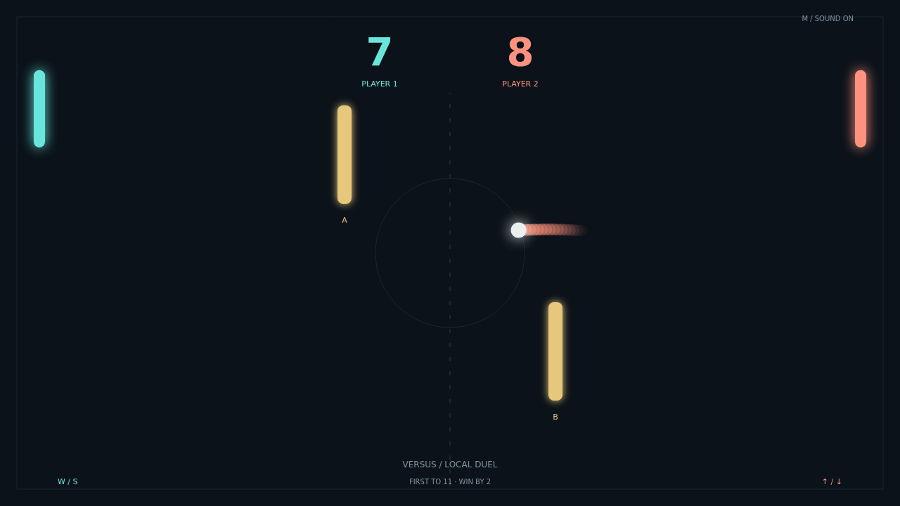

# Carom

Two paddles. Two obstacles. A thousand ways to find an angle. Carom is a fast paddle duel where a moving strike bends the ball’s flight, turning each return into a chance to surprise your opponent.

The opening serve gives you a moment to take position, then the rally starts building speed. Meet the ball squarely to drive it across the court, or catch it at your paddle’s edge to send it climbing toward a wall. Keep moving through contact and watch your shot curl.

The gold bars split the court into tempting bank shots and awkward rebounds. A clear lane can disappear in a bounce; a desperate save can become the perfect attack. Follow the fading trail, read the curve, and make the next angle yours.

Challenge the computer in Solo or face a friend in a local Versus match. Reach eleven with a two-point lead to win. At ten-all, every return matters—and the rally keeps going until someone earns the gap.

